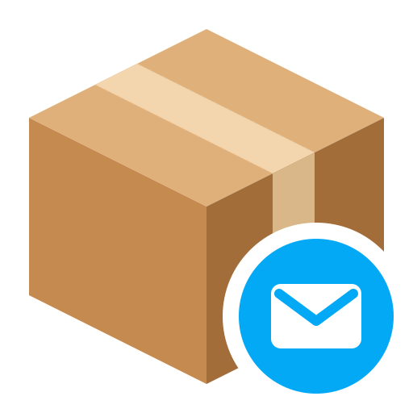
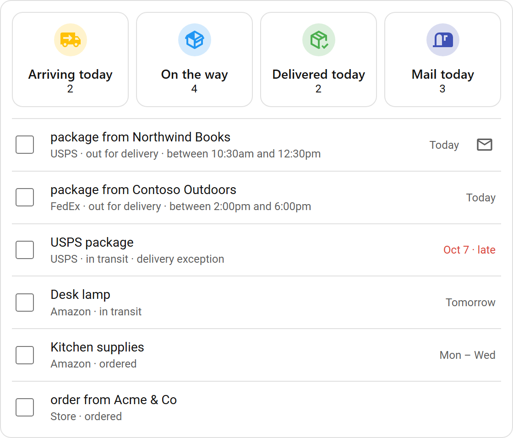
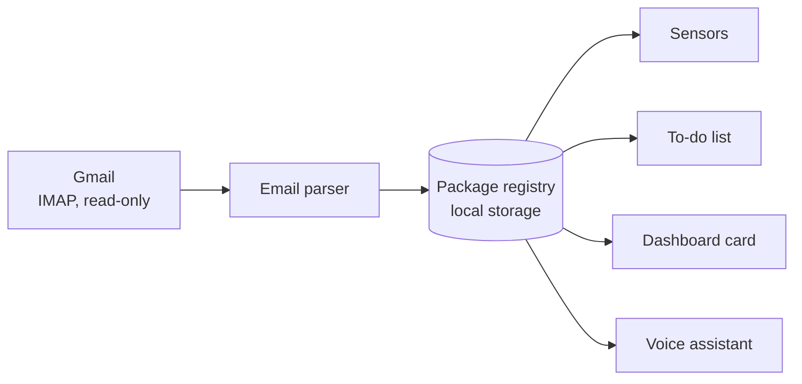
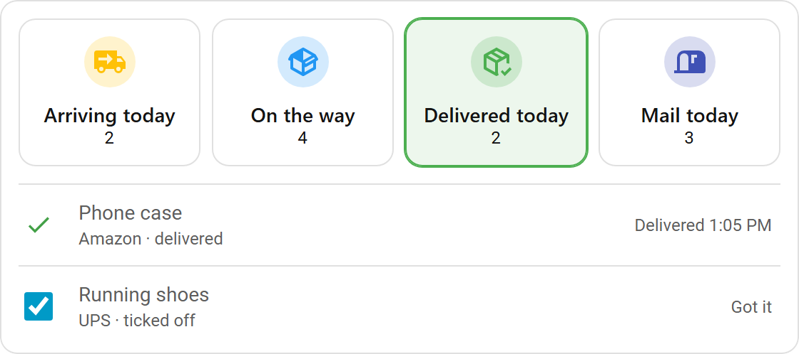

# Package Tracker for Home Assistant

Turns the shipping emails in your Gmail into a live package list for Home Assistant, with sensors, a to-do list, a dashboard card and voice answers.

[](https://hacs.xyz/docs/faq/custom_repositories/)
[](https://www.home-assistant.io/)
[](LICENSE)
[](https://github.com/joefaiella/ha-package-tracker/actions/workflows/tests.yml)

<picture>
  <source media="(prefers-color-scheme: dark)" srcset="docs/images/card-dark.png">
  
</picture>

## Why

- **Packages stay when emails go.** Packages are kept in the integration's own registry, so archiving or deleting a shipping email doesn't remove its package. A finished package can't be brought back by an older email either.
- **Never marks mail as read.** Messages are fetched with IMAP `BODY.PEEK`, so nothing is marked read, flagged, moved or deleted.
- **No tracking service.** It talks only to Gmail. Parsing and storage happen inside Home Assistant, with no carrier API keys or third-party account.
- **Many carriers.** Amazon, USPS (including Informed Delivery), UPS, FedEx, Walmart, Etsy, Shopify stores and other online stores. Emails are matched to packages by tracking number, Amazon box or order number.
- **Works with shared store accounts.** If your Amazon account is shared with family at another address, enter your addresses and only your packages appear.

## Features

- Sensors for packages arriving today, out for delivery, on the way, delivered today and ordered, plus today's mail count from USPS Informed Delivery.
- A **Packages** to-do list with one item per package, due on its expected date. Tick it off when the package arrives.
- A bundled dashboard card. Its tiles filter the list, and each row opens the carrier's tracking page, the Amazon order or the original email. It loads automatically, so there's no dashboard resource to add.
- Voice assistant support, for questions like "what's arriving today?" or "did my headphones ship?".
- Delivery windows ("between 2:00pm and 6:00pm"), expected-date ranges, and flags for late packages and delivery problems.
- A "probably delivered" status for carriers that never send a delivered email.
- Spoofed shipping emails are ignored. Gmail's DMARC and DKIM results are checked against the sender's domain, and mail that fails is skipped.
- Tracking numbers are validated with the carrier's check digit, where the carrier uses one.
- More than one Gmail account. The card combines them.

## How it works



1. **Reading.** Each check opens one IMAP session and reads **All Mail** and **Trash** from where the last check stopped. A check runs every 10 minutes by default. It reads only the sender and subject of each new email. It downloads the full email only when those look like shipping mail, and skips emails it has already read.
2. **Parsing.** The parser identifies the sender. It then extracts the status, tracking numbers, order number, item names, expected date, delivery window and delivery address.
3. **Registry.** Each email is merged into a package, matched by tracking number, Amazon shipment ID or order number. A package's status moves forward and "delivered" is final. The one step back is out for delivery to in transit, when a newer email reschedules the delivery. Delivered packages are kept for the number of days set in the options, then retired. Delivered and probably-delivered packages leave a record for 45 days after that, so an older email processed late can't bring them back.
4. **Everything else.** The sensors, to-do list, card and voice assistant all read the same registry, filtered by your delivery addresses.

**Probably delivered.** Not every carrier sends a "delivered" email. A package is marked probably delivered once its expected date has passed with no news since, and mail has been checked since then:

- USPS packages, if you get Informed Delivery: on the first day after the expected date whose digest doesn't list the package.
- Everything else, and USPS without a digest: two days after the expected date.

A reported delay or delivery problem holds the package open until a week passes with no news.

## Supported senders

| Sender | Emails it understands | Delivery address in the email |
| --- | --- | --- |
| Amazon | Ordered, shipped, out for delivery, delivered, delivery updates, shipping delays. Each box is tracked separately. | First name and town |
| USPS | Tracking updates: in transit, out for delivery, ready for pickup, delivered, delivery problems, expected date and window | Town and ZIP code |
| USPS Informed Delivery | Daily Digest: today's mail count, and packages arriving today, arriving soon, or awaiting the sender | None (it only lists mail for your own address) |
| UPS | Shipped, scheduled, out for delivery, delivered, new delivery date, delivery attempts, delays | Full address, when the email shows one |
| FedEx | Shipped, out for delivery, delivered, delivery exceptions, delays | Full address, when the email shows one |
| Walmart | Shipped, out for delivery, delivered | None |
| Etsy | Shipped, delivered | Name and address |
| Shopify stores and ParcelPanel | Order confirmed, shipped, out for delivery, delivered | Name and address |
| Other online stores | Shipped, out for delivery and delivered emails. Only from senders that pass Gmail's DMARC or DKIM check, and only with a labelled tracking number or a carrier tracking link. | None |

Tracking numbers in store emails are recognized for USPS, UPS, FedEx, DHL, OnTrac and LaserShip, GOFO, and Amazon Logistics. Numbers are checked against the carrier's check digit where the carrier has one.

Clicking a package opens one of these:

- The carrier's public tracking page, for USPS, UPS, FedEx, DHL, OnTrac and GOFO.
- Amazon's tracking page for the box, or the order page before it ships, for Amazon packages.
- The email in Gmail, for anything else.

## Installation

Requires Home Assistant 2026.10 or newer.

### HACS (recommended)

[](https://my.home-assistant.io/redirect/hacs_repository/?owner=joefaiella&repository=ha-package-tracker&category=integration)

1. In HACS, open the three-dot menu and choose **Custom repositories**.
2. Add `https://github.com/joefaiella/ha-package-tracker` with the type **Integration**.
3. Find **Package Tracker** in HACS and download it.
4. Restart Home Assistant.

### Manual

1. Copy `custom_components/package_tracker` from this repository into your Home Assistant `config/custom_components/` folder.
2. Restart Home Assistant.

## Setup

1. **Create a Gmail app password.** App passwords need 2-Step Verification turned on for your Google account. Go to <https://myaccount.google.com/apppasswords>, create an app password (the name can be anything, such as "Home Assistant") and copy it. You can paste it with or without the spaces.
2. **Check IMAP.** If your Gmail settings still show an IMAP option (**Settings > See all settings > Forwarding and POP/IMAP**), make sure IMAP is enabled.
3. **Add the integration.** Go to **Settings > Devices & services > Add integration** and choose **Package tracker**, or use this button:

   [](https://my.home-assistant.io/redirect/config_flow_start/?domain=package_tracker)

4. **Sign in.** Enter your Gmail address and the app password. The login is checked straight away, including that the account is a Gmail account.

The first check reads the last 14 days of mail, so packages already on the way appear right away. To track several mailboxes, add the integration once for each Gmail account.

## Options

Go to **Settings > Devices & services > Package tracker > Configure**. Changes take effect immediately.

| Option | Default | What it does |
| --- | --- | --- |
| Check Gmail every | 10 min (5–120) | How often to look for new shipping emails. |
| Look back on first check | 14 days (1–30) | How far back the first check reads. Gmail keeps deleted mail in Trash for 30 days. |
| Keep delivered packages for | 2 days (1–14) | How long a delivered package is remembered. The card and sensors show a delivery only on its day, but the voice assistant can still answer about it, and "probably delivered" to-do items stay ticked, for this long. |
| Delivery address | empty | Only show packages going to these addresses (up to 10). Leave it empty to show every package. |
| Show packages when the email doesn't say where they're going | on | Many carrier emails, including most from USPS and UPS, don't name the delivery address. When this is on, those packages are shown. When it's off, they stay hidden until an email shows they're coming to one of your addresses. |
| Always show packages from USPS Informed Delivery | on | Informed Delivery only lists mail coming to your own address, so these packages are shown even if no other email names an address. |

### Delivery addresses

This option is useful when a store account, usually Amazon, is shared with people at another address. Type each address the usual way:

| Entry | What it matches |
| --- | --- |
| `123 Main St, Springfield, IL 62701` | That full address, or the ZIP code or town when that's all an email gives |
| `Springfield, IL` | Anything going to that town |
| `62701` | Anything with that ZIP code. Amazon emails have no ZIP code, so add the town too. |
| `Jane Doe, 123 Main St, Springfield, IL 62701` | That address, like the first row. Emails that give only a first name and town (Amazon) must also name Jane or J. |
| `Jane - Springfield, IL` | Anything going to that town, but only if the email's recipient is Jane or J. Carrier emails addressed to someone else at your address are hidden too, so prefer the row above. |
| `Jane` | Anything whose delivery name or address contains "Jane" |

How matching works:

- Each kind of email reveals a different part of the address (see [Supported senders](#supported-senders)). Your entries and the emails go through the same address parser, and only the parts both sides have are compared: ZIP code, town, state, and house number and street.
- If the ZIP codes match, a town spelled differently doesn't count against it.
- Amazon emails show only the recipient's first name and town (`Jane - SPRINGFIELD, IL`), so Amazon packages are matched by town. If another household on the account lives in the same town, put your name in front of your full address, for example `Jane Doe, 123 Main St, Springfield, IL 62701`. Amazon packages are then told apart by first name (an initial also counts), while carrier emails are still matched by ZIP code and street whoever they're addressed to.
- An entry with no comma, ZIP code, state or house number is treated as a keyword. It matches if it appears anywhere in the delivery name or address.
- A package is shown if any of its emails matches any entry. A package whose emails never name an address, or name one that can't be compared with your entries (for example a ZIP-code-only entry against Amazon's town-only emails), follows the "show packages when the email doesn't say" option. Amazon boxes take the address from their order.

The **Last email check** sensor's `hidden_by_address_filter` attribute shows how many packages are currently hidden.

## Dashboard card



The card's JavaScript is served by the integration and loaded on every dashboard automatically. Add the card from the card picker (it's listed as **Package tracker**), or in YAML:

```yaml
type: custom:package-tracker-card
mail_url: https://informeddelivery.usps.com/  # optional, must be https
```

- **Tiles.** **Arriving today**, **On the way** and **Delivered today** show counts. **Delivered today** also counts packages you ticked off, so it can be higher than the sensor of the same name. Tap a tile to show only those packages, and tap it again to show everything. **Mail today** shows today's Informed Delivery count and opens `mail_url`, which is USPS Informed Delivery by default.
- **Rows.** Without a filter, the list shows every package that hasn't arrived yet. Tap a row to open its tracking page: the carrier's site, the Amazon order, or the email in Gmail. When the row opens a carrier or Amazon page, an envelope button opens the original email. Late packages show their expected date in red.
- **Ticking off.** Tick the box when a package arrives ("Got it"), and untick it to undo. A green check means the carrier confirmed delivery. Ticking needs the same permission as changing the Packages to-do list.
- **Live updates.** The card updates as soon as a check finds something new or a package is ticked anywhere, with no page refresh.

## Entities

Each Gmail account gets one **Package tracker** device. Entity IDs below are the defaults.

| Entity | Default entity ID | State |
| --- | --- | --- |
| Arriving today | `sensor.package_tracker_arriving_today` | Out for delivery, or shipped and due today |
| Out for delivery | `sensor.package_tracker_out_for_delivery` | On the truck today |
| On the way | `sensor.package_tracker_on_the_way` | Shipped and moving: in transit, out for delivery or ready for pickup |
| Delivered today | `sensor.package_tracker_delivered_today` | Delivered today, as confirmed by an email |
| Ordered | `sensor.package_tracker_ordered` | Ordered but not shipped yet |
| Mail today | `sensor.package_tracker_mail_today` | Mail pieces in today's Informed Delivery digest (0 until it arrives; see `digest_received`) |
| Packages | `todo.package_tracker_packages` | Packages not yet delivered, plus today's deliveries |
| Last email check (diagnostic) | `sensor.package_tracker_last_email_check` | Time of the last successful Gmail check |

- **Package sensors.** These list up to 25 packages in a `packages` attribute. Each entry has the item, carrier, status, expected date (and `expected_end` for a range), delivery window, a `late` flag, any problem as text (`exception`), delivery time, the time of the last email and the last four digits of the tracking number. The list is left out of the recorder, so it doesn't fill your history database.
- **Packages to-do list.** Each item is due on the package's expected date. Its description shows the carrier, status, delivery window and any problem. Ticking an item marks the package received. Unticking a "probably delivered" package tells the tracker it hasn't arrived yet. Items can't be added, renamed or deleted, because they come from your email.
- **Last email check.** This sensor has these attributes:
  - `last_error`: the reason the most recent check failed, if it did.
  - `headers_checked`, `emails_read` and `shipping_emails`: what the last check did.
  - `hidden_by_address_filter`: only present when the delivery address filter is set.

Example automation:

```yaml
triggers:
  - trigger: state
    entity_id: sensor.package_tracker_delivered_today
    not_from: [unknown, unavailable]
conditions:
  - "{{ trigger.to_state.state | int(0) > trigger.from_state.state | int(0) }}"
actions:
  - action: notify.notify
    data:
      message: "A package was just delivered."
```

## Voice assistant

The integration gives Home Assistant's voice assistant a package lookup tool (`package_tracker__get_packages`). It works with assistants that are set up to control Home Assistant through the Assist API.

To turn it on, expose at least one Package tracker entity to the assistant. For example, expose **Arriving today** in **Settings > Voice assistants > Expose**. The tool is offered only to assistants that can see a Package tracker entity.

You can then ask questions like these:

- "What packages are coming today?"
- "Did my headphones ship?"
- "When is the FedEx package coming?"
- "What was delivered today?"
- "Do I have mail today?"

The tool respects the delivery address filter. Only the last four digits of a tracking number are ever shared with the assistant.

## Privacy and security

- **Mailbox access.** Besides logging in and opening folders, the integration only lists, searches and fetches with `BODY.PEEK`, which never sets the read flag. It never stores, moves, flags or deletes mail.
- **Minimal reading.** For each new email it reads only the sender and subject. The full email is downloaded only when those look like shipping mail.
- **Credentials.** The app password is stored in the integration's config entry, like any other integration's credentials. You can revoke it at any time from your Google account.
- **Local data.** Package data is kept in Home Assistant's private `.storage` folder and deleted when you remove the integration. The integration itself only connects to Gmail. If you expose it to a voice assistant that runs in the cloud, the package details the assistant asks for (item names, carriers, dates and the last four digits of tracking numbers) are sent to that service.
- **Diagnostics.** These contain the option values, package counts by carrier and status, scan positions, and the last check's error and statistics. Delivery addresses are replaced by a count, and there are no email contents, item names or tracking numbers.
- **Spoofing protection.** Shipping emails that fail Gmail's sender checks are ignored. An unknown store also needs a verified sender, a labelled tracking number, and a sender name that doesn't pose as a carrier or Amazon.
- **The card.** All text that comes from an email is escaped before it is shown. The card only follows `https` links: package links are built from fixed carrier, Amazon and Gmail templates, and the **Mail today** link is the `mail_url` you set. Ticking a package off checks the user's permissions on the server. Anyone who can log in to your Home Assistant can see the card's data, including full tracking numbers in its links.

## Troubleshooting

- **"Gmail didn't accept that address and app password."** Use an app password, not your Google account password. App passwords need 2-Step Verification.
- **Home Assistant asks you to re-authenticate.** Google revokes app passwords when your Google password changes. Create a new app password and enter it in the re-authentication prompt under **Settings > Devices & services**.
- **The card shows "Configuration error".** The browser is running a page that was loaded before the card's JavaScript was available, for example right after installing or updating. Do a hard refresh (Ctrl+Shift+R, or Cmd+Shift+R on a Mac). In the companion app, close and reopen the app.
- **The card says "Couldn't check Gmail".** The last check failed, usually because of the network or a temporary refusal from Gmail. Known packages stay listed and the next check tries again. The `last_error` attribute of **Last email check** has the details.
- **Gmail limits.** Gmail limits how many IMAP connections an account can have at once and how much it can download per day.
  - The tracker uses one short session per check and skips emails it has already read.
  - Temporary refusals, such as too many connections or a bandwidth limit, are retried on the next check and never ask for a new password.
  - On a very large mailbox, the first check looks at the newest 4,000 messages per folder within the look-back period. Each check reads up to 1,500 headers per folder and continues where it left off.
- **A package is missing.** Check the `hidden_by_address_filter` attribute. Also remember that the first check only reads back as far as the look-back setting. To see why an email was skipped, turn on debug logging:

  ```yaml
  logger:
    logs:
      custom_components.package_tracker: debug
  ```

## Development

The tests run on Linux or macOS. On Windows, use WSL.

```bash
python3.14 -m venv .venv
source .venv/bin/activate
pip install -r requirements_test.txt
ruff check .
ruff format --check .
pytest
```

`dev/card-harness.html` previews the card in a browser with made-up packages, without Home Assistant:

```bash
python -m http.server 8799 --bind 127.0.0.1
# open http://127.0.0.1:8799/dev/card-harness.html (?theme=dark, ?width=360, ?filter=on_the_way)
```

| Module | Purpose |
| --- | --- |
| `imap_client.py` | Read-only Gmail IMAP scanner (aioimaplib) |
| `kb.py` | Sender rules, tracking-number patterns and check digits, status and date parsing |
| `address.py` | Delivery-address extraction and matching |
| `registry.py` | Package registry: merging, status rules, retirement, views |
| `links.py` | Tracking-page and Gmail links |
| `coordinator.py` | Polling, storage and storage upgrades |
| `sensor.py`, `todo.py`, `llm.py` | Sensors, the Packages to-do list, the voice assistant tool |
| `websocket.py`, `frontend/` | Live data for the dashboard card, and the card itself |

`kb.py`, `address.py`, `registry.py` and `links.py` don't use Home Assistant themselves, so their tests need no running instance (the package's `__init__.py` still imports it).

See [CONTRIBUTING.md](CONTRIBUTING.md) for how to contribute.

## License

[MIT](LICENSE) © 2026 Joe Faiella
